# Application Flow

This documentation provides the end-to-end flow of the application, helps you initiate the setup, and guides you in observing and validating the results.

> [!NOTE]
> **New design: Smart Classroom is now a desktop app.** The UI has been redesigned since the
> previous release:
>
> - The ☰ menu at the top left is the main navigation. It opens **Home**, **Content Search**, and
>   **Smart Grading**, plus the **Get started**, **Setup**, **Configuration**, and **Services**
>   tools.
> - **Report** and **History** buttons sit at the right of the toolbar on the Home screen.
> - The right panel has new **Performance Metrics**, **Resource Utilization**, and
>   **Class Engagement** views.
>
> Screenshots in this guide show the current desktop app.

You can start the application by using **Upload Files** or by clicking **Start Recording**. This documentation guides you through the upload files option.

## Step 1: Upload Files

Click **Upload Files** in the toolbar, or **Upload File** in the video area, to open the upload
dialog. Choose a file for each input you have: **Audio File**, **Front Camera File**,
**Back Camera File**, and **Board Camera File**. Each input opens a file picker.

Accepted file formats:

- Audio: *.mp3 or .wav or .m4a*
- Video: *.mp4*

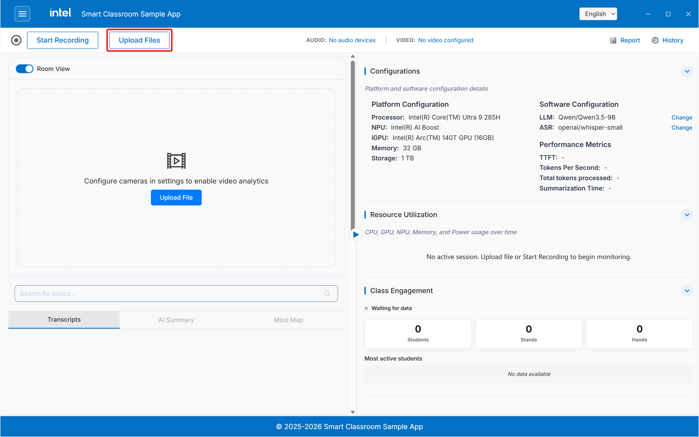
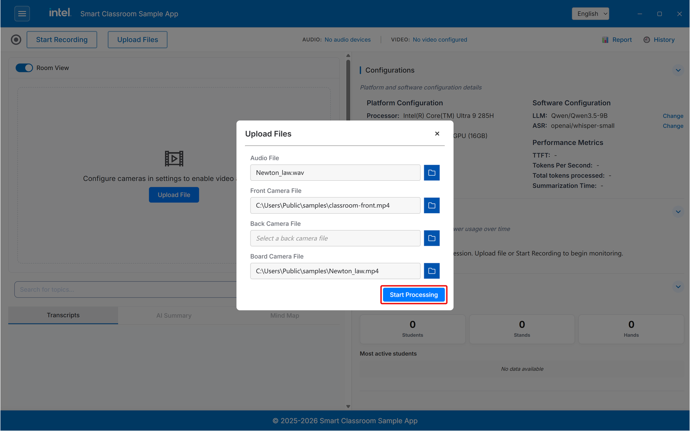

**After selecting the files, click Start Processing.**

> [!NOTE]
> Search is enabled only after content segmentation.

## Step 2: Audio Analysis and Video Streaming

The application starts transcription after analyzing the audio, and the videos are streamed in parallel as shown below.

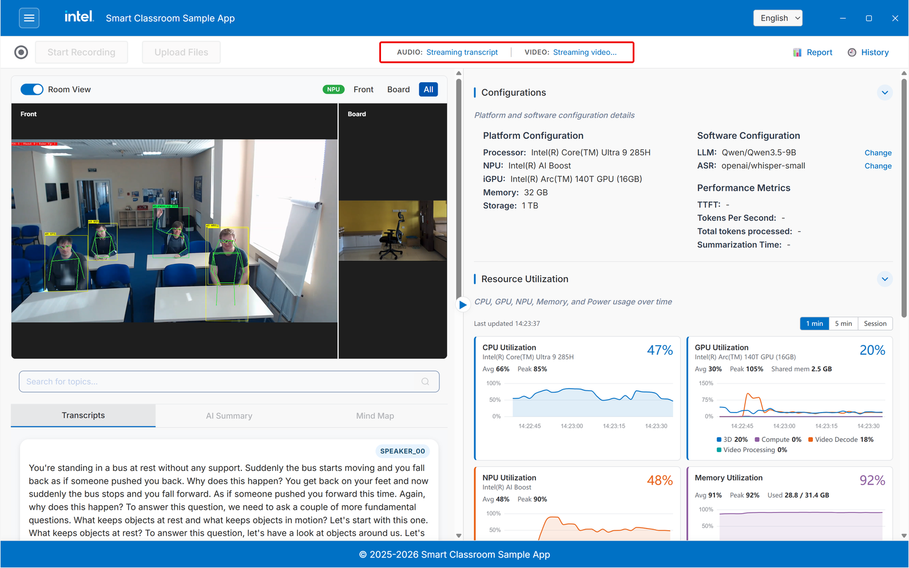

### Right Panel

- **Configurations** - The platform (processor, NPU, iGPU, memory, storage) and the models in use.
  Click **Change** next to **LLM** or **ASR** to switch models.
- **Performance Metrics** - Measured for the current session's summarization:
  - **TTFT** - Time to first token.
  - **Tokens Per Second** - Generation throughput.
  - **Total tokens processed** - Tokens processed by the LLM for the session.
  - **Summarization Time** - Time taken to produce the summary.
- **Resource Utilization** - Live CPU, GPU, NPU, Memory, and Power cards. Each card shows the
  current value with **Avg** and **Peak**, over the last **1 min**, **5 min**, or the whole
  **Session**. The GPU card breaks utilization down into 3D, Compute, Video Decode, and Video
  Processing, and shows shared GPU memory.
- **Class Engagement** - Live counts of students, stand-ups, and raised hands, the most active
  students, and the speaking timeline.

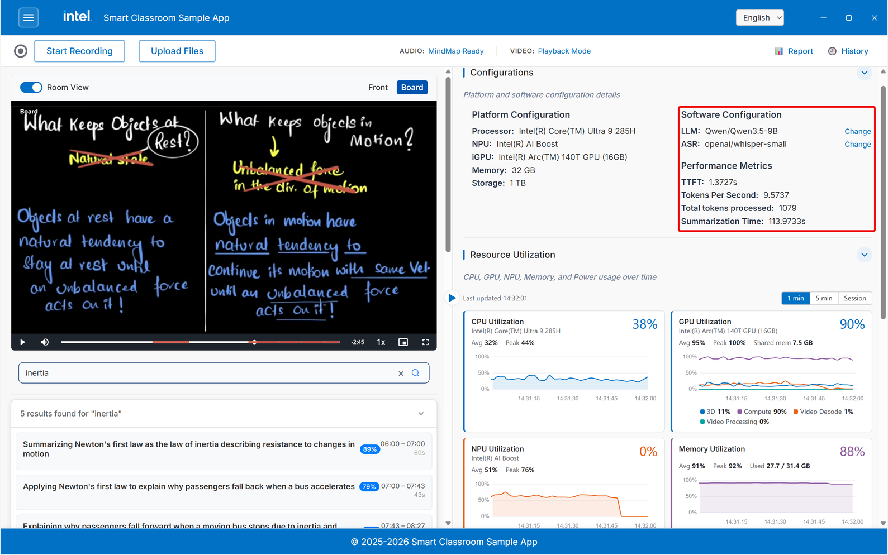

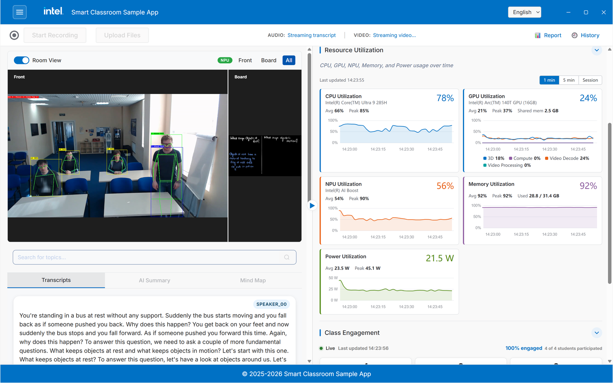

## Step 3: Tabs Switch

The user can switch between tabs as shown below:

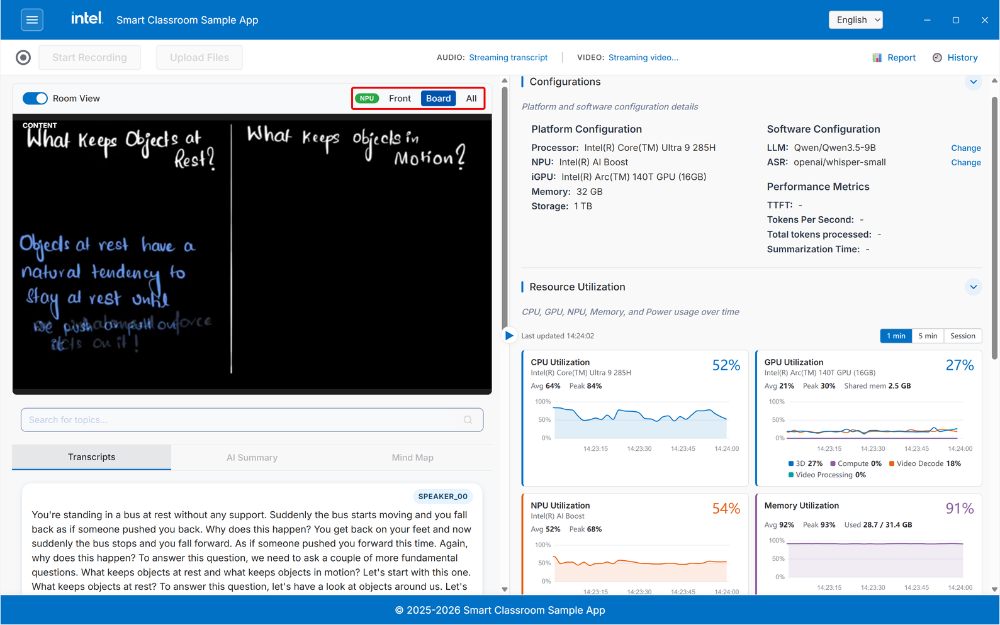

The Room View toggle switches between full audio–video mode and audio-only mode. When disabled, the video component is hidden and only the audio panel remains visible.

## Step 4: Transcription and Speaker Timeline

*Once the teacher is identified, labels are updated accordingly:*

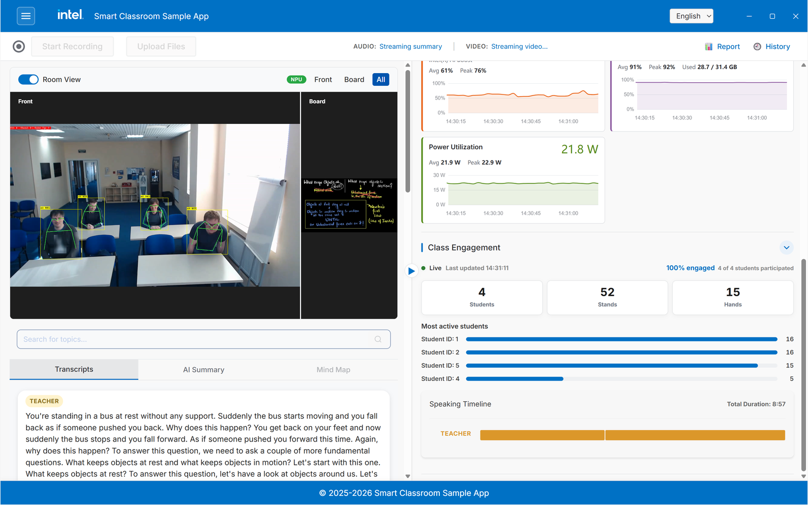

## Step 5: Content-Segmentation

*After the MindMap is generated and video processing is completed, content segmentation starts and video playback is enabled for video search.*

- Audio+Video: content segmentation is enabled after the MindMap is generated and video processing is completed.

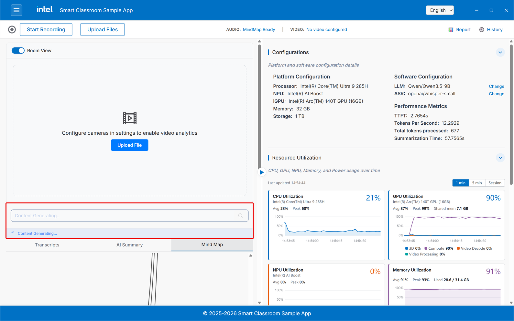

## Step 6: Final State

- Audio: After transcription and post summary, MindMap gets generated
- Video: After video processing, playbackMode is enabled and, based on the topic search, the results are shown
- VideoSearch: Based on the search results, the video timeline is highlighted at the respective timestamps of the topic

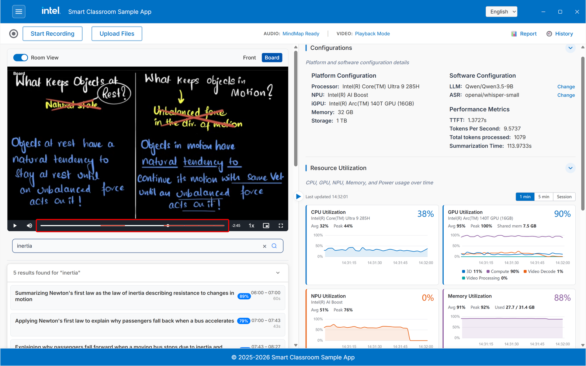

## Step 7: Class Report

Once processing settles, a structured **Class Report** is generated from the session. It
combines the measured data collected during processing (attendance, speaking speed, hand-raise
counts, keywords, mind map, and so on) with an AI-generated teaching assessment, and can be
downloaded as a Word or PDF document.

Open it with the **Report** button at the right of the toolbar.

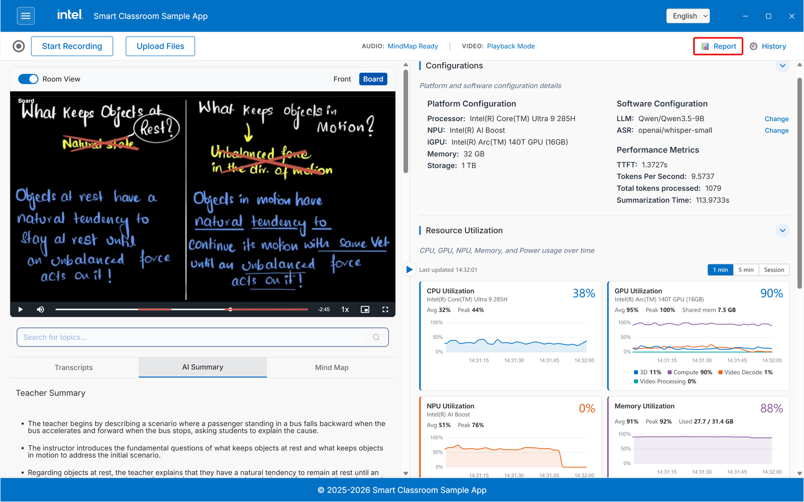

For details, see the [Class Report Flow](./class-report-flow.md).

## Step 8: Session History

**History** is new in this release. Every recording and upload is saved as a session on this
machine, and processing stages that run after the class (summary, mind map, topic segmentation,
report) continue in the background. Click **History** at the right of the toolbar to open the
**Session history** panel, which lists the sessions newest first.

Each row shows when the session started, its state (**Running**, **Completed**, **Failed**, or
**Cancelled**), its source files, and a colored marker for each stage.

- **Mark failed** - Shown for a running session. Use it for a session that is stuck.
- **Delete** - Removes the session and every file it produced. It is disabled while the session is
  running.

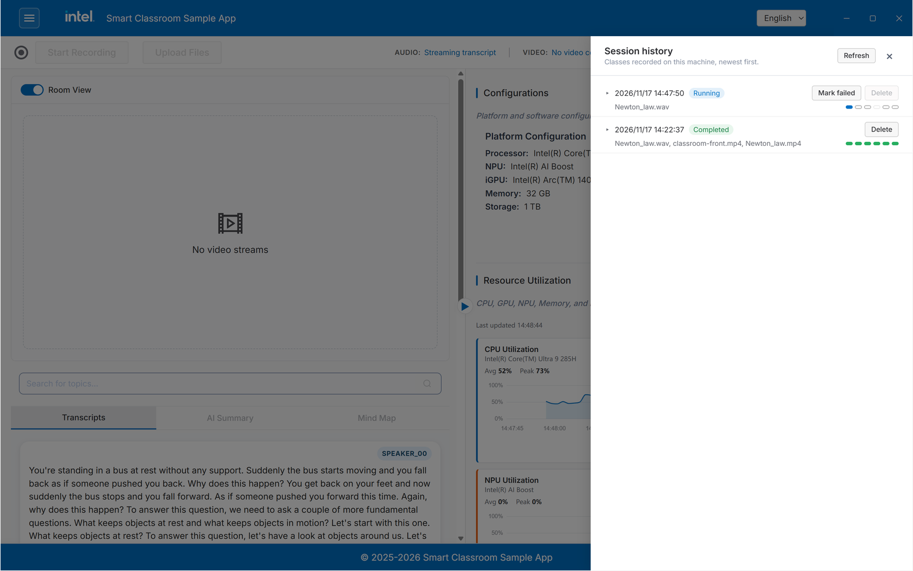

Click a row to expand it. The stage table lists each stage with its status, duration, and details.

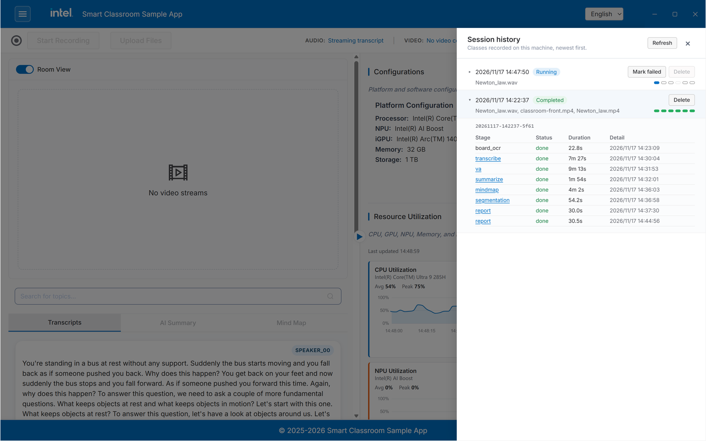

A stage that wrote an output file appears as a link. Click it to open the file, such as the
transcript, summary, mind map, or report, in a viewer.

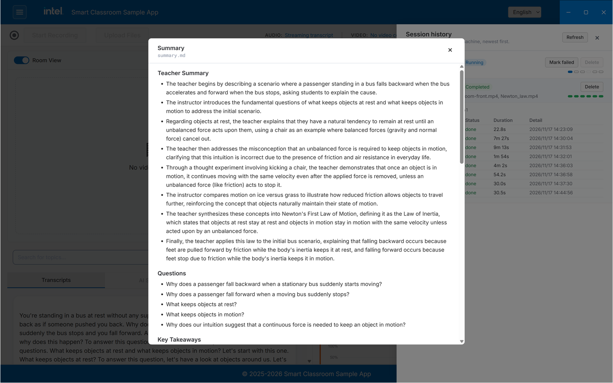

## Step 9: Grading

Scanned exam papers can be scored automatically. You provide a folder of papers (PDF) and a
rubric, and the system renders the pages, splits them into question sections, and uses a
Vision-Language Model to grade each section and produce scores with reasoning.

Open it from **Smart Grading** in the ☰ menu. The entry is disabled unless
`features.grading.enabled` is set to `true` in `config.yaml`.

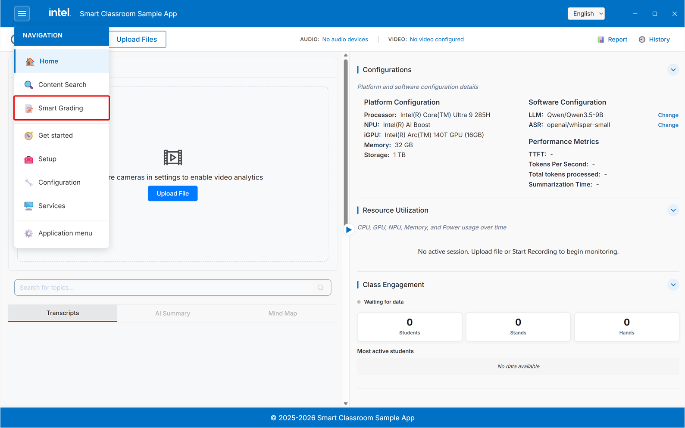

For details, see the [Grading Flow](./grading-flow.md).

## Learn More

- [How It Works](./how-it-works.md): Technical architecture and design details.
- [Content Search Flow](./content-search-flow.md): The flow of the content search functionality.
- [Class Report Flow](./class-report-flow.md): The flow of generating and exporting a class report.
- [Grading Flow](./grading-flow.md): The flow of grading scanned exam papers.
