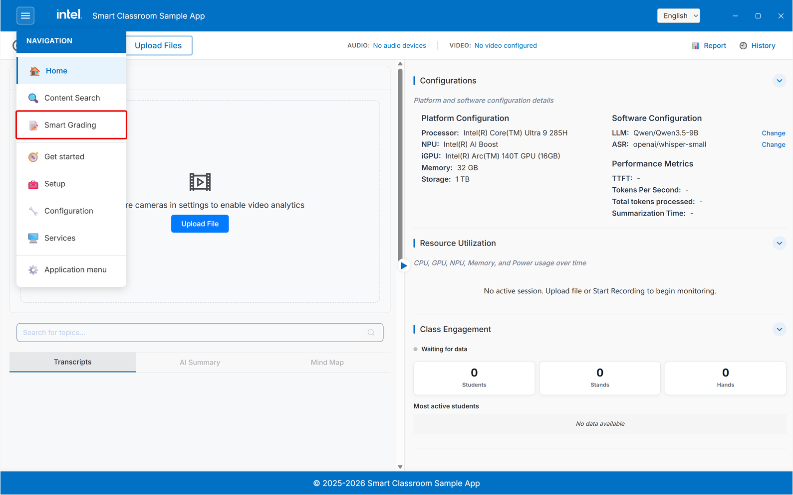
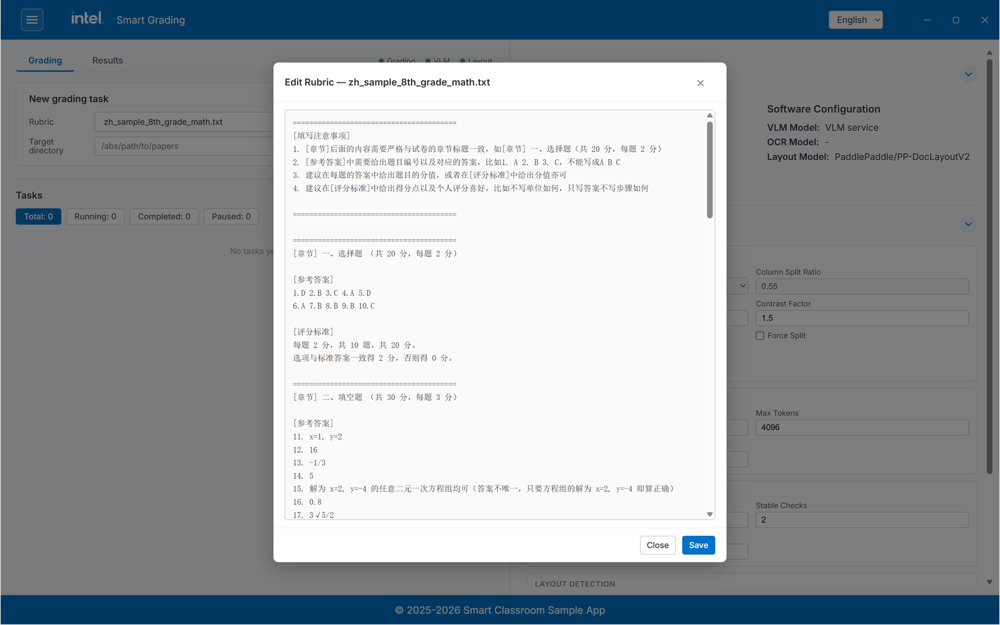
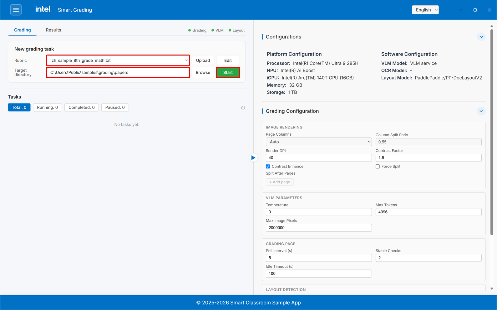
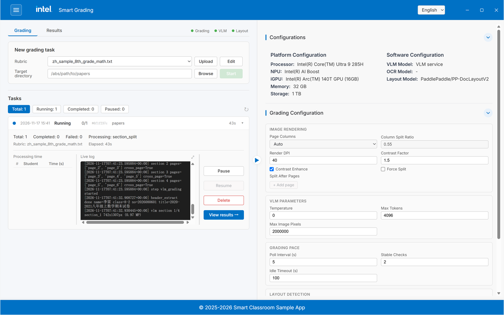
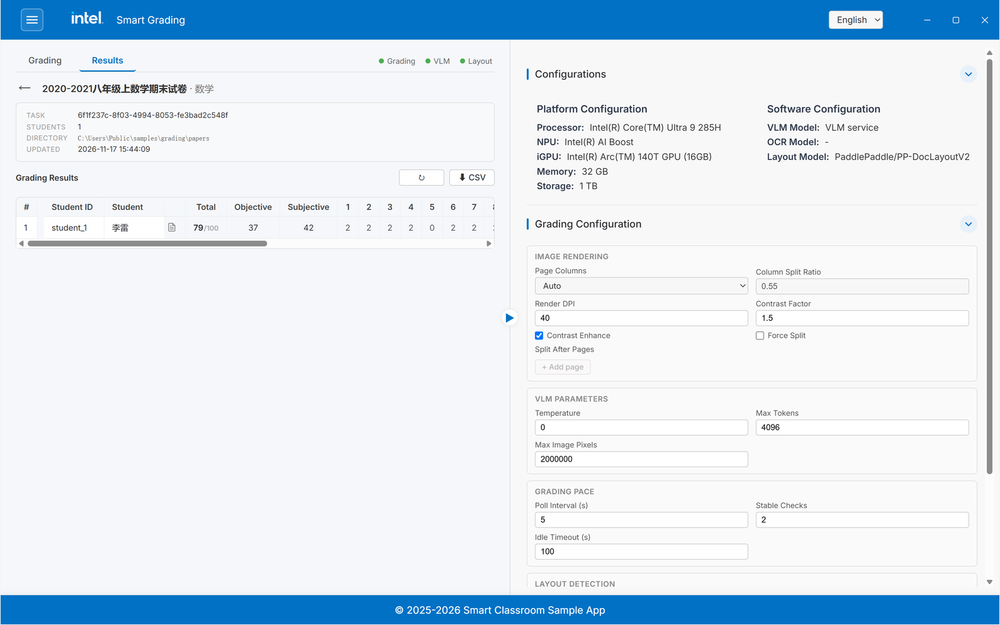
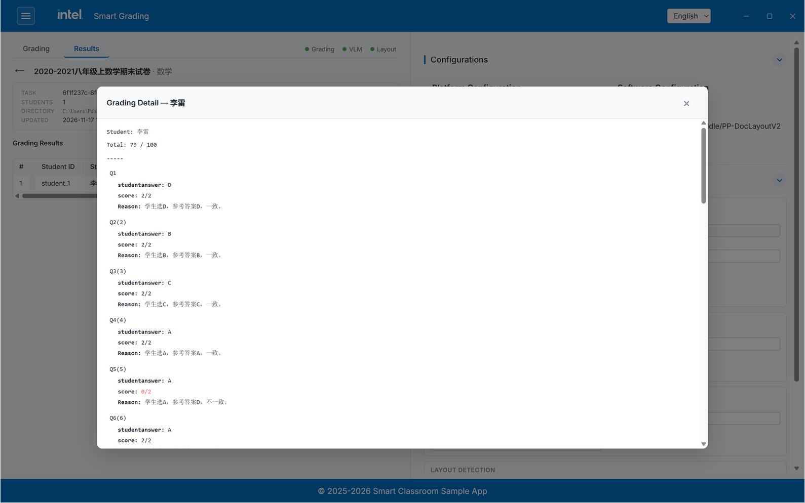

# Grading Flow

> [!IMPORTANT]
> **Language requirement:** Grading currently supports Chinese exam papers only. Before using the
  Grading feature, make sure the `language` setting in the main program's `config.yaml` is set to
  `zh`, and enable the feature with `features.grading.enabled: true`.

The Grading feature automatically scores scanned exam papers. You provide a folder of papers
(PDF) and a rubric, and the system renders the pages, splits them into sections, and uses a Vision-Language
Model (VLM) to grade each section and produce a structured result with scores and reasoning.

To enter the Grading view, open the ☰ menu at the top left of the Smart Classroom app and click
**Smart Grading**:



## Step 1: Prepare a Rubric

A rubric tells the model how to grade. Upload one before creating a task:

1. Click **Upload** next to the **Rubric** list and select a `.txt` or `.json` file.
2. The uploaded rubric is added to the **Rubric** list and selected.
3. To change it, click **Edit**, edit the text, and click **Save**.



## Step 2: Create a Grading Task

1. Select the rubric to grade against in the **Rubric** list.
2. Set **Target directory** to the folder that holds the papers. Type the path, or click
   **Browse** to pick the folder. The folder can hold one subfolder per student
   (`<folder>/<student>/*.pdf`) or the PDF files directly (`<folder>/*.pdf`).
3. Click **Start**.



The task runs through four steps automatically:

| Step | What happens |
| :--- | :--- |
| **Render** | The PDF is converted to page images. |
| **Layout detection** | Each page is analyzed to locate text, titles, tables, and formulas. |
| **Section split** | Pages are grouped into question sections, stitched across page breaks. |
| **VLM grading** | Each section image and its rubric are sent to the VLM, which returns scores and reasoning. |

## Step 3: Track Progress

The **Tasks** list shows each task's status and how many papers are done. Use the **Total**,
**Running**, **Completed**, and **Paused** chips to filter the list. Click a task to expand it and
see the step it is processing, the time spent per student, and a live log. Use **Pause**,
**Resume**, and **Delete** to control the task, and **View results →** to open its results.



## Step 4: View Results

When a task completes, expand it in the **Tasks** list and click **View results →**. The results
open in the **Results** tab:

- **Score summary** - One row per student with the total, objective, and subjective scores, and
  the score of each question. Click **⬇ CSV** to export the table.

  

- **Per-question breakdown** - Click the document icon next to a student's name to open
  **Grading Detail**, with each question's student answer, score, and the model's reasoning.

  

## Try a Built-in Sample

The repository ships with a set of ready-to-grade sample exams under
`components/grading/samples/` (a copy is provided for both the Linux and
Windows layouts). Use them to try the Grading feature end-to-end before you
prepare your own material.

### Included samples

| Subject | Layout | Paper | Rubric |
| :--- | :--- | :--- | :--- |
| Chinese | Single column | `exam/zh_5th_grade_chinese_single_column/scan_single_column.pdf` | `rubrics/zh_sample_5th_grade_chinese.txt` |
| Math | Double column | `exam/zh_8th_grade_math_double_column/student_1/scan_double_column.pdf` | `rubrics/zh_sample_8th_grade_math.txt` |
| English | Double column | `exam/zh_9th_grade_english_double_column/student_1/scan_double_column.pdf` | `rubrics/zh_sample_english_exam.txt` |
| Physics | Single column | `exam/zh_9th_grade_physics_single_column/student_1/scan_single_column.pdf` | `rubrics/zh_sample_physics_exam.txt` |

For example, to try the 5th-grade Chinese sample:

1. **Copy the rubric into the grading directory.** The rubric list is loaded
   only from the grading component's own `components/grading/rubrics/`
   directory (its root, not a subfolder). Copy the sample rubric there:

   ```bash
   cp components/grading/samples/rubrics/zh_sample_5th_grade_chinese.txt \
      components/grading/rubrics/
   ```

   It now appears in the **Rubric** list. You can also add it with the **Upload** button
   instead of copying it.
2. **Create a task as described above**, and select:
   - **Rubric**: `zh_sample_5th_grade_chinese.txt` (from the rubric list)
   - **Target directory**: `components/grading/samples/exam/zh_5th_grade_chinese_single_column`

The page layout (single vs double column) is detected automatically — the
**Page Columns** setting defaults to **Auto**, so there is nothing to choose.
Leave it at **Auto**.

Enter the full path of the folder under `samples/exam/`, or pick it with **Browse**.

### Add your own sample

To run a rubric against your own material, follow the same convention:

1. **Copy the rubric file into `components/grading/rubrics/`** — the only
   location the system loads rubrics from *at its root*, not nested in a
   subfolder. Only `.txt` and `.json` files in that root directory are listed
   (`.json` files must be valid JSON). Follow the same sectioned rubric
   structure as the bundled samples: each question section carries a title
   header, an answer-key block, and a scoring-criteria block. The exact block
   labels are localized, so copy one of the bundled rubric files and edit it as
   a starting point rather than inventing new labels.
2. Put the scanned papers in a folder, one subfolder per student or the PDF files directly, and
   set that folder as the **Target directory** when creating the task.

Page layout (single vs double column) is detected automatically by default
(`page_columns: auto` in `components/grading/config.yaml`). You only need to
override it if automatic detection is wrong for a particular paper — set
**Page Columns** to **1** or **2** in the grading panel.

## Models

| Model | Role | Device |
| :--- | :--- | :--- |
| PP-DocLayout | Page layout detection | NPU |
| PP-OCR | Read section titles | CPU |
| Qwen VLM | Grade sections | GPU |

## Learn More

- [Application Flow](./application-flow.md): End-to-end application flow.
- [How It Works](./how-it-works.md): Technical architecture and design details.
